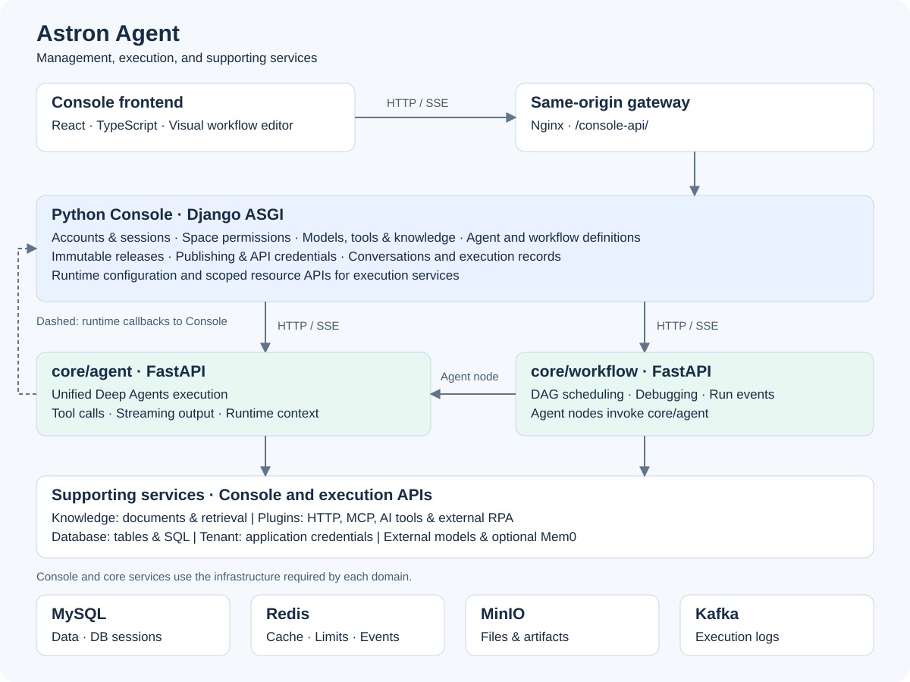

# Astron Agent Project Modules

## Project Overview

**Astron Agent** is an enterprise-grade, commercially-friendly Agentic Workflow development platform that integrates AI workflow orchestration, model management, AI & MCP tools, RPA automation, and team collaboration features.

## Architecture Diagram



---

## Module List

### UI Layer

#### 1. Console Frontend

**Module Path**: `console/frontend/`

**Language**: TypeScript + React

**Main Responsibilities**:
- Provide web user interface (SPA - Single Page Application)
- Agent creation and configuration UI
- Visual workflow editor
- Knowledge base management interface
- Model management and configuration
- Real-time chat window
- Multi-tenant space management

**Tech Stack**: React 18, TypeScript 5, Vite 5, Ant Design 5, Tailwind CSS, ReactFlow, Recoil/Zustand

---

### Console Backend Layer

#### 2. Console Backend

**Module Path**: `console/backend/`

**Language**: Python

**Main Responsibilities**:
- Provide REST API and SSE interfaces for management console
- User authentication and permission management
- CRUD interfaces for Agent, Workflow, and Knowledge
- Model management and configuration APIs
- File upload/download services
- Data statistics and analytics
- Immutable release snapshots, publication credentials, and execution records
- Space membership and scoped resource authorization

**Tech Stack**: Django 5.2, ASGI, Django ORM, session authentication and CSRF

**Domain modules**: accounts, spaces, resources, knowledge, agents, workflows, publishing.

---

### Core Microservices Layer

#### 3. Agent Service

**Module Path**: `core/agent/`

**Language**: Python

**Main Responsibilities**:
- Agent core execution engine
- Unified Deep Agents execution for independent Agents and workflow Agent nodes
- Execute Agent configurations supplied by Console
- Tool invocation and plugin integration
- Execution context, streaming output, and tool-call state

**Tech Stack**: FastAPI, SQLAlchemy 2.0, Pydantic, OpenTelemetry

**Architecture Design**: Follows DDD (Domain-Driven Design) with API layer, service layer, domain layer, and repository layer

---

#### 4. Workflow Service

**Module Path**: `core/workflow/`

**Language**: Python

**Main Responsibilities**:
- Workflow orchestration and execution engine (Spark Flow)
- Multi-step process automation
- Execute workflow snapshots supplied by Console
- DAG scheduling and streaming execution events
- Visual workflow runtime debugging

**Tech Stack**: FastAPI, SQLModel, SQLAlchemy 2.0, Kafka (event streaming), LangChain

**Execution path**: Console invokes the workflow service over HTTP/SSE; Agent nodes call `core/agent`. Kafka carries execution logs using the configured `KAFKA_TOPIC`.

---

#### 5. Knowledge Service

**Module Path**: `core/knowledge/`

**Language**: Python

**Main Responsibilities**:
- Knowledge base management and document processing
- Document vectorization and semantic search
- RAG (Retrieval-Augmented Generation) implementation
- LLM integration and embeddings generation
- Support for multiple document format parsing

**Tech Stack**: FastAPI, RAGFlow SDK, OpenAI API, SQLModel, Redis

**Invocation**: Console and execution services access document and retrieval APIs over HTTP.

---

#### 6. Memory DB Service

**Module Path**: `core/memory/`

**Language**: Python

**Main Responsibilities**:
- Database creation, deletion, and metadata management
- Table schema operations (DDL)
- Data queries and updates (DML) for workflow database nodes

Console manages conversation history and integrates optional Mem0 long-term memory.

**Tech Stack**: Python, database abstraction layer

---

#### 7. Tenant Service

**Module Path**: `core/tenant/`

**Language**: Go

**Main Responsibilities**:
- Application registration and management
- Application API key creation, update, deletion, and verification

Console owns space membership, roles, and resource authorization.

**Tech Stack**: Go 1.23, Gin framework, MySQL

**Design Philosophy**: Implemented in Go for high performance and low memory overhead

---

### Plugin System

#### 8. Plugin: AI Tools

**Module Path**: `core/plugin/aitools/`

**Language**: Python

**Main Responsibilities**:
- Integration with iFLYTEK AI tools (IFLYTEX API)
- Third-party AI tool integration
- Tool invocation management and result caching

**Tech Stack**: FastAPI, HTTP Client

---

#### 9. Plugin: RPA

**Module Path**: `core/plugin/rpa/`

**Language**: Python

**Main Responsibilities**:
- RPA process automation
- Invoke configured external RPA tasks
- Retrieve execution results
- Integration with external RPA executors

**Tech Stack**: FastAPI, RPA SDK

---

#### 10. Plugin: Link

**Module Path**: `core/plugin/link/`

**Language**: Python

**Main Responsibilities**:
- HTTP tool definition and version management
- HTTP tool execution and debugging
- MCP tool discovery and invocation

**Tech Stack**: FastAPI, HTTP Client

---

### Common Services Layer

#### 11. Common Module

**Module Path**: `core/common/`

**Language**: Python

**Main Responsibilities**:
- Provide cross-project common services and utilities
- Authentication and audit system (MetrologyAuth)
- Observability support (OTLP, OpenTelemetry)
- Database, cache, and message queue connection management
- Unified logging system
- OSS (MinIO) object storage integration

**Tech Stack**: Python, SQLModel, Redis Client, Kafka Client, OpenTelemetry

**Core Value**: Provide unified infrastructure abstraction for all Python microservices

---

## Infrastructure Components (Data Mgmt & Messaging)

### Data Persistence
- **MySQL**: Console accounts, DB-backed sessions, configuration, releases, and execution records; service-specific structured data
- **Redis**: Cache, rate limits, and execution event registry
- **PostgreSQL**: Optional auxiliary database

### Message Queue
- **Kafka**: Execution log reporting. Topic names come from each service’s configuration (`KAFKA_TOPIC`); HTTP/SSE carries the main execution calls.

### Object Storage
- **MinIO**: File storage service (PUT/GET operations)

---

## External Service Integrations

### LLM Providers
- Integration with multiple large language model services (OpenAI, Azure OpenAI, local models, etc.)
- Unified LLM invocation interface

### IFLYTEX API
- iFLYTEK AI tool API integration
- Invoked through AI Tools plugin

### RPA Executors
- External RPA automation executors
- Task distribution and execution via RPA plugin

---

## Module Dependencies

### Hierarchical Structure

```
UI Layer
    └── Console Frontend (React/TS)
         ↓ HTTP/REST/SSE

Console Backend Layer
    └── Console Backend (Python Django ASGI)
         ↓ HTTP/REST/SSE

Core Microservices Layer
    ├── Agent Service (Python FastAPI)
    ├── Workflow Service (Python FastAPI)
    ├── Knowledge Service (Python FastAPI)
    ├── Memory DB Service (Python)
    ├── Tenant Service (Go Gin)
    ├── Plugin: AI Tools (Python FastAPI)
    ├── Plugin: Link (Python FastAPI)
    └── Plugin: RPA (Python FastAPI)
         ↓

Common Services Layer
    └── Common Module (Python)
         ↓

Data & Messaging Layer
    ├── MySQL (Relational Database)
    ├── Redis (Cache/Events)
    ├── Kafka (Event Streaming)
    └── MinIO (Object Storage)

External Services
    ├── LLM Providers (Large Language Models)
    ├── IFLYTEX API (iFLYTEK API)
    └── RPA Executors (RPA Executors)
```

### Communication Patterns

| Communication Path | Protocol | Description |
|-------------------|----------|-------------|
| Frontend → Backend | HTTP/REST, SSE | REST API calls and server-sent events |
| Backend → Core Services | HTTP/REST, SSE | Resource operations, execution requests, and streamed results |
| Workflow → Agent / Knowledge / Plugins / Database | HTTP, SSE | Node execution and resource access |
| Agent → Console | Internal HTTP APIs | Scoped runtime configuration and resource access |
| Core Services → MySQL | MySQL drivers / SQLAlchemy | Data persistence |
| Core Services → Redis | Redis Protocol | Cache and execution events |
| Core Services → Kafka | Kafka Protocol | Execution log reporting |
| Core Services → MinIO | MinIO API (PUT/GET) | File upload/download |
| Plugins → External Services | HTTP/gRPC | External API calls |

---

## Module Dependency Matrix

| Module | Dependencies | Dependents |
|--------|-------------|------------|
| **Console Frontend** | Console Backend | - |
| **Console Backend** | Agent, Workflow, Knowledge, Tenant, Plugins, Database | Console Frontend; Agent runtime callbacks |
| **Agent Service** | Common, Plugins (AI Tools/Link/RPA), Memory | Workflow, Console Backend |
| **Workflow Service** | Common, Agent, Plugins | Console Backend |
| **Knowledge Service** | Common, LLM Providers | Agent, Workflow, Console Backend |
| **Memory DB Service** | Common | Console Backend, Workflow |
| **Tenant Service** | MySQL | Application credential management and verification callers |
| **Plugin: AI Tools** | Common, IFLYTEX API | Agent, Workflow |
| **Plugin: RPA** | Common, RPA Executors | Agent, Workflow |
| **Plugin: Link** | Common | Agent, Workflow |
| **Common Module** | MySQL, Redis, Kafka, MinIO | All Python services |

---

## Technology Stack Summary

| Layer | Module | Language/Framework | Version |
|-------|--------|-------------------|---------|
| **Frontend** | Console Frontend | TypeScript + React | TS 5.9.2, React 18.2.0 |
| **Backend** | Console Backend | Python + Django | Python 3.11, Django 5.2 |
| **Microservices** | Agent Service | Python + FastAPI | Python 3.11+, FastAPI 0.115+ |
| | Workflow Service | Python + FastAPI | Python 3.11+, FastAPI 0.115+ |
| | Knowledge Service | Python + FastAPI | Python 3.11+, FastAPI 0.115+ |
| | Memory DB Service | Python | Python 3.11+ |
| | Tenant Service | Go + Gin | Go 1.23, Gin 1.10.1 |
| **Plugins** | AI Tools Plugin | Python + FastAPI | Python 3.11+, FastAPI 0.115+ |
| | RPA Plugin | Python + FastAPI | Python 3.11+, FastAPI 0.115+ |
| | Link Plugin | Python + FastAPI | Python 3.11+, FastAPI 0.115+ |
| **Common** | Common Module | Python | Python 3.11+ |
| **Data** | MySQL | Relational Database | MySQL 5.7+ |
| | Redis | Cache/In-memory DB | Redis 6.0+ |
| | Kafka | Message Queue | Kafka 2.5.0+ |
| | MinIO | Object Storage | MinIO 8.5.10 |

---

## Development Standards

### Python Modules
- **Architecture**: DDD (Domain-Driven Design)
- **Code Style**: Black + isort
- **Type Checking**: MyPy
- **Code Analysis**: Pylint, Flake8
- **Testing**: Pytest (coverage ≥ 70%)

### Python Console
- **Architecture**: Django domain modules with ASGI streaming
- **Checks**: Ruff, Django migration checks and Django test runner
- **Execution**: core/agent and core/workflow own runtime orchestration

### TypeScript Modules
- **Code Style**: ESLint + Prettier
- **Type Checking**: TypeScript strict mode
- **Testing**: Node.js test runner (`npm run test:unit`)

### Go Modules
- **Code Style**: Go fmt
- **Code Analysis**: Go vet, Golint

---

## Related Documentation

- [Project README](/README)
- [Deployment Guide](/DEPLOYMENT_GUIDE)
- [Configuration Guide](/CONFIGURATION)
- [Agent Development Guide](../core/agent/CLAUDE.md)
- [Frontend Development Guide](../console/frontend/CLAUDE.md)

---

**Document Version**: v1.0
**Last Updated**: 2026-11-06
