# 功能与使用 FAQ

## 为什么一句话创建智能体失败？

提示词创建智能体时，如果点击立即创建，需要调用讯飞开放平台的模型能力，请先将AstronAgent与您的讯飞开放平台的应用进行绑定（参考部署文档），然后领取对应模型的额度即可。或者直接点击跳过，使用第三方模型进行会话。

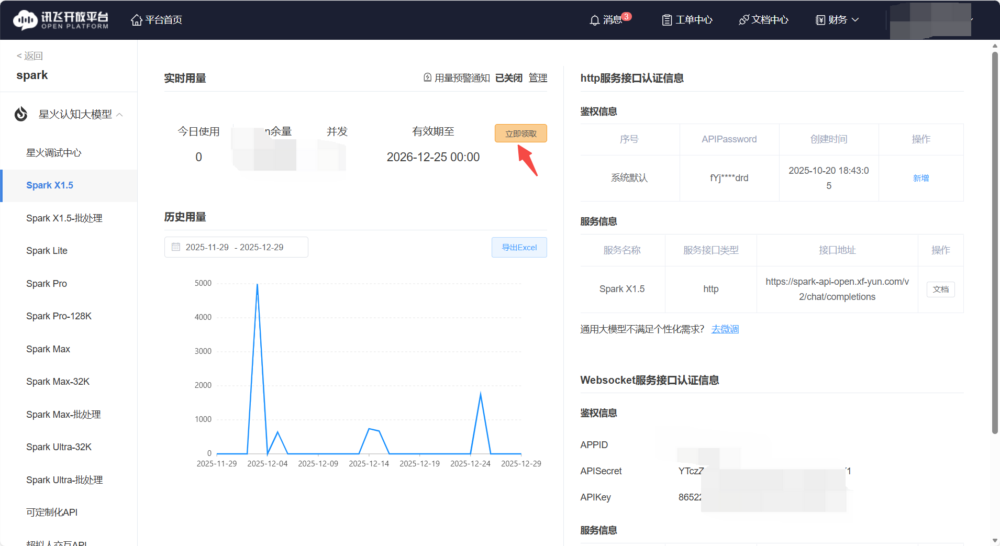
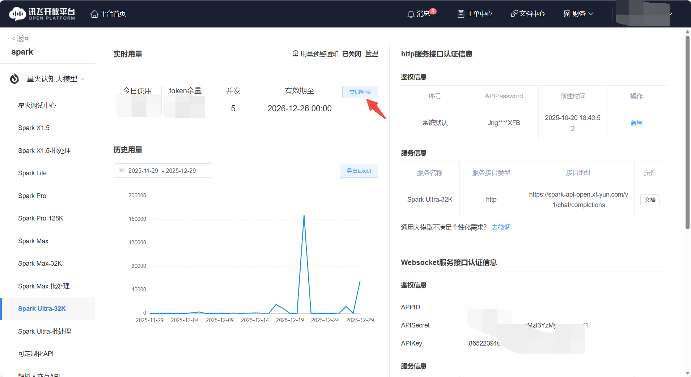

## 工作流创建失败或显示异常 (Unknown column)？

1. 原因: 数据库表结构版本落后。
2. 解决: 检查后端日志，若出现 Unknown column 'module_id'  或 type  等错误，需在数据
库执行相应的 ALTER TABLE  语句补全字段（如 alter table c_param add column
module_id varchar(50) DEFAULT NULL ）。

## 知识库 (Knowledge Base) 常见问题？

1. 文件上传失败:
- 检查 MinIO 服务是否正常，端口（如 18998/18999）是否开放。
- 检查 Agent 与 RAGFlow、MinIO 之间的网络连通性及环境变量配置。
2. RAGFlow 同步: 目前支持从 Agent 上传同步至 RAGFlow；直接在 RAGFlow 上传的文件需在 Agent 端进行关联操作才能使用。
3. Rerank 模型: 星火知识库默认启用 Rerank。

## 怎么使用虚拟人？

在AstronAgent中使用虚拟人技术需要在讯飞虚拟人官网中申请对应的服务并配置到环境变量中：
1. 打开讯飞虚拟人官网https://virtual-man.xfyun.cn/，进入应用控制台

2. 点击左侧边栏中的接口服务
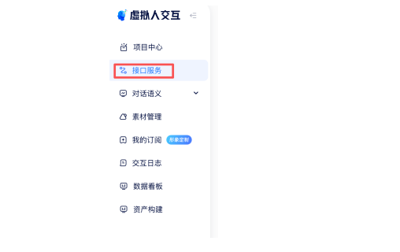
3. 点击右侧详情的免费开通
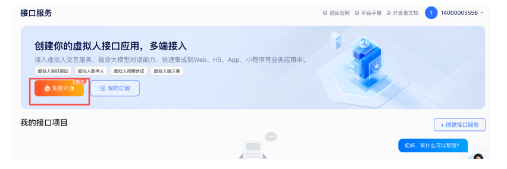
4. 按照自身信息填写表单并进行提交
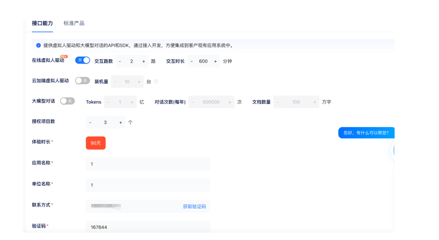
5. 提交成功后，自动跳转页面，若后续进入，可直接点击左侧我的订阅栏目
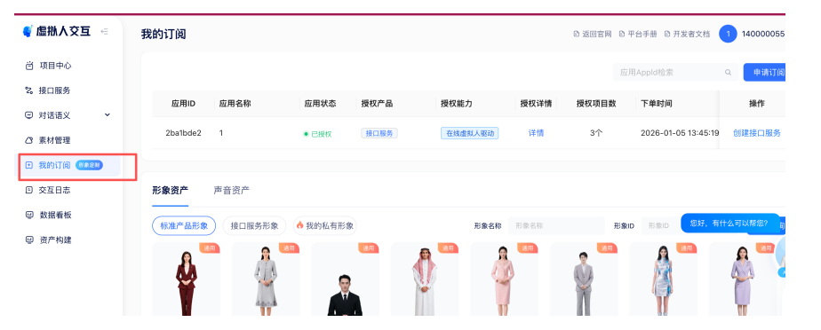
6. 点击创建接口服务
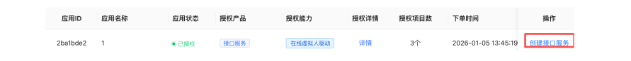
7. 点击右上角创建接口服务，填写表单
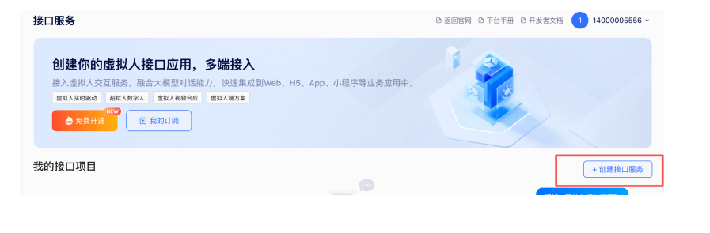
8. 获取应用三元信息，并点击发布按钮
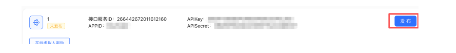
9. 将应用三元信息填入对应.env对应配置项内，启动/重启docker compose服务即可使用

⚠️特别注意因虚拟人需要用到浏览器的媒体捕获 API navigator.mediaDevices，所以需要https或者localhost这种安全环境，若您没有这样的环境，chrome浏览器可以设置绕过检查，具体设置如下：
1. 打开 chrome://flags/#unsafely-treat-insecure-origin-as-secure
2. 搜索 Insecure origins treated as secure，找到此项，并设置为：已启用（否则无法无效）
3. 在输入框填写您的地址，如：http://172.29.192.11，如果有多个，请用英文逗号分隔即可
4. 保存重启浏览器，即可生效

## 变量如何使用？

1. 引用方式: 在节点输入框中使用 {{变量名}}  引用上游节点输出或全局变量。
2. 迭代节点: 在迭代节点内部，使用当前迭代项变量（如 item ）进行处理。

## 如何自定义原子组件？

目前需要修改代码并手动更新数据库中的原子树信息。后续版本将提供更便捷的自定义组件开发方式。

## 支持自定义 MCP (Model Context Protocol) 工具吗？

支持。MCP 既可以作为独立的「MCP 节点」直接加入工作流，也可以在 Agent 智能决策节点里作为工具添加和配置。

## 知识库（RAG）引用有问题，无法检索或回答？

1. 早期版本的对话型 Agent 在引用知识库时可能存在 Bug，建议更新到最新版本的镜像。
2. 工作流模式下引用知识库通常更稳定。

## 知识库 (RAG) 如何防止模型幻觉？

1. 检索到的知识库内容会作为上下文填充到 Prompt 中发送给模型。

2. 可以通过修改提示词（Prompt）来约束模型：例如添加“请仅依据检索到的内容回答，如果检索
内容中没有答案，请直接回复不知道，不要编造”。

## 已发布的应用如何删除或下架？

- 目前版本（开源版）可能在界面上未直接提供“下架”按钮。
- 通常需要在“我的智能体”卡片中查找删除选项。
- 如果找不到下架/删除入口，可能是当前版本的已知问题（Issue），建议关注 GitHub 仓库的修复
进度。

## 智能体发布需要人工审核吗？

是否需要审核取决于所在空间：

- 个人空间（免费版 / 专业版）：不需要审核，调试通过后即可直接发布。
- 团队 / 企业空间：所有者（Owner）和管理员（Admin）可直接发布；普通成员（Member）发布到智能体市场或 API 渠道时，需经所有者或管理员审核通过后才会上架。

## 控制台与工作流引擎各负责什么？

Python Console 负责账号、资源、Agent、工作流和发布的管理与授权；`core/workflow` 负责工作流编排；`core/agent` 是独立 Agent 与工作流 Agent 节点的共享执行引擎。

Console 与工作流使用各自的数据库（`astron_console` 和 `workflow`），原用户 ID 与资源归属保持不变。

## 开源版工作流有可观测性 / Trace 吗？

有，默认未开启，按以下步骤启用：

1. 在 docker-compose.yaml 中取消 elasticsearch、kibana、kafka、logstash 四个组件容器的注释。
2. 将环境变量 KAFKA_ENABLE 置为 1。
3. 重新启动项目，即可在工作流的 Trace 日志中查看对应的调用链路。

## 怎么使用 HTTPS 协议访问项目？

在应用入口部署 TLS，前端和 `/console-api/` 保持同源。按 [Python Console 运维说明](../console/backend/README.md) 设置公开 origin、允许主机、可信 CSRF origin 和安全 Cookie；只信任明确配置的代理来源。登录和注册直接在应用内完成，不需要额外认证端口。

## 工作流可以导入 / 导出吗？导入入口在哪里？

支持。

- **导出**：在工作流列表或编排页的操作菜单里点「导出」，会下载一份工作流描述文件。
- **导入**：入口在**创建页**（新建智能体/工作流的模板选择页），分类筛选一行的右侧有「导入工作流」按钮，点击后在弹窗中上传文件即可。

导入文件要求：格式为 `yml` / `yaml`，大小不超过 20M。上传其他格式或超过限制会被前端直接拦截并给出提示。

## 工作流开始节点里 file（如 pdf）类型的字段，后续怎么消费？

平台没有内置的“文件解析节点”，开始节点收到的文件变量需要交给有执行能力的节点去处理，常见三条路线：

1. **插件 / API / 代码类节点**：把文件变量作为入参传进去，由你自己的服务或所接能力完成解析、抽取文本、OCR、摘要。
2. **RPA 节点**：偏桌面/办公自动化的场景，交给 RPA 处理文件。
3. **知识库路线**：如果目标是“基于 PDF 问答”，更合适的做法是先把 PDF 上传进知识库，再在流程里走知识库检索，而不是把开始节点的文件直接丢给大模型节点。

## 怎么让 Agent 用上 SkillHub 的技能？read_skill 和 run_skill 有什么区别？

在 Agent 能力配置页的 Skill 模块中导入技能后，运行时会为每个技能生成两个工具：

- `read_skill_*`：读取技能包内容。首次调用传空参数会读到 `SKILL.md` 并拿到资源清单；如果 `SKILL.md` 里引用了相对路径（例如 `references/beijing.md`），再带上该路径调用即可读取对应文件。**不需要沙箱**。
- `run_skill_*`：在已配置的脚本沙箱中执行技能包里的命令，并返回执行结果。**需要管理员先在资源管理中配置脚本沙箱**，否则运行时会明确提示“当前环境未配置脚本沙箱”。

两个常见误解：

- 它不是本地 Agent，**不能随意读取你机器上的任意文件**，只能读技能包内的内容并按 `SKILL.md` 的描述行动。
- 技能里可以有多个脚本，但必须在 `SKILL.md` 中写清楚何时调用哪个脚本；模型是按 `SKILL.md` 的说明来决定行为的。

## 如何接入自己服务器上启动的 MCP Server？

关键是把它暴露成一个**平台容器能访问到的完整 URL**，然后在 MCP/工具配置里填写该地址：

1. MCP 服务监听 `0.0.0.0`，不要只绑 `127.0.0.1`，否则容器内访问不到。
2. 填写完整地址而不是主机名片段，例如 `http://10.0.0.12:8080/sse` 或 `https://mcp.example.com/mcp`。
3. 同机房 / 同内网部署填内网地址；公网部署填公网地址并确保端口放通。
4. Docker 部署时注意容器视角的可达性：容器里的 `localhost` 指的是容器自身，不是宿主机。

## 二次开发改了前端品牌文案，为什么页面上没生效？

前端资源是构建进镜像的，改完源码需要**重新构建镜像并替换正在运行的镜像**，只重启容器不会生效：

1. 用对应模块 `build` 目录下的 Dockerfile 重新构建镜像；
2. 用新镜像替换 compose 中引用的官方镜像；
3. 重新 `up -d` 使新镜像生效。

后端（Python / Go 服务）的定制同理，各服务都可以按自己的 Dockerfile 重新出镜像。如果改动只覆盖了一部分文案，通常是还有其他模块（例如后端返回的文案或另一个前端子应用）没有一并重建。

## 在线体验、SaaS 版和开源自建版是什么关系？

- **在线体验版**：部署在云端的开源版实例，用于零环境成本试用，不建议存放正式数据。
- **SaaS 版**（`agent.xfyun.cn`）：官方托管的商业服务，账号体系、额度与开源自建版彼此独立，网页版的会员额度不能用于私有化部署实例。
- **开源自建版**：自己用 Docker Compose / Helm 部署，数据完全自持，模型可以接入任意 OpenAI 协议兼容服务。

三者代码同源但环境隔离，账号、数据、额度都不互通。

## 新版本里「一句话创建智能体」还需要绑定讯飞开放平台吗？

不需要。新版本中 Agent 内置的 AI 能力已经与讯飞开放平台解耦，只需在 `.env` 中配置任意 OpenAI 协议兼容模型的 URL 和 Key，即可自动调用该模型完成一句话创建。

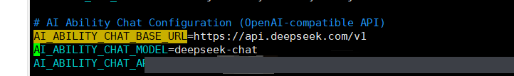

## 怎么切换中英文界面？

点击左下角的用户头像，在弹出菜单中点击「EN」即可切换到英文界面，再次操作可切回中文。

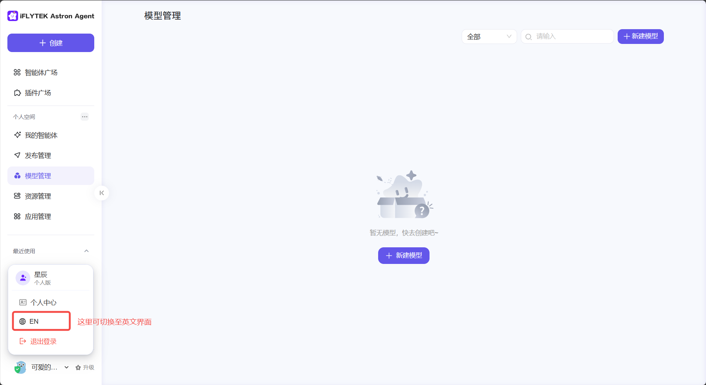

## 工作流调试时，怎么查看中间节点的输入输出？

调试运行结束后，点击对应节点右上角的绿色箭头，会展开「运行结果」面板，可以看到该节点的**输入**、**原始输出**和**输出**三段内容，便于定位是哪个节点的数据不对。

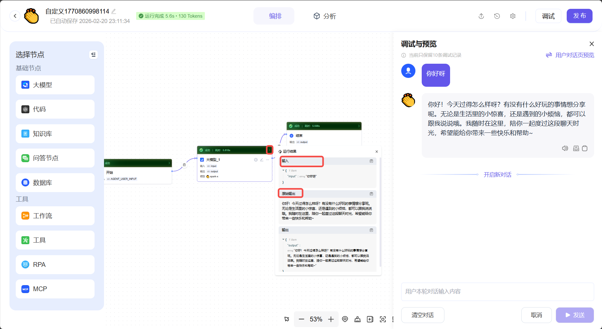

## 工作流中代码节点执行超时怎么办？

打开代码节点配置面板底部的「异常处理」开关，把「超时时间」调整为合理值，并按需设置重试次数与异常处理方式。

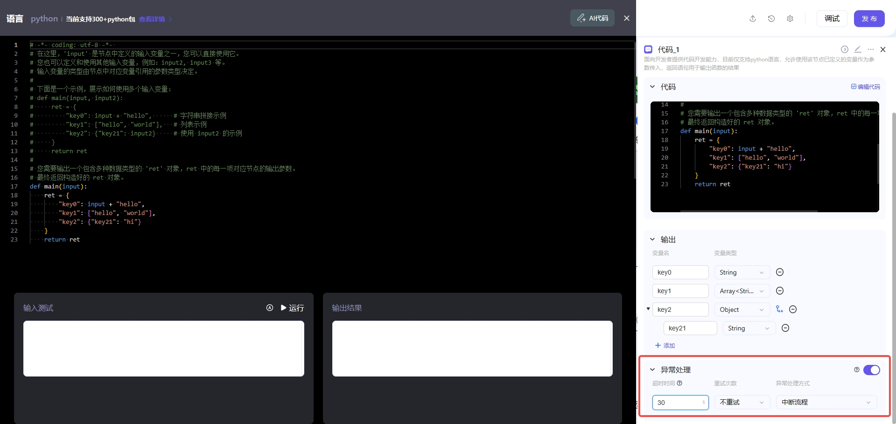

## 工作流点「发布」没反应 / 发布不成功？

发布前需要先补全工作流的基本信息：进入工作流编排页，在**左上角**填写工作流名称等必填信息，再点右上角的「发布」。基本信息不完整时，发布会失败或点击后没有响应。

## 怎么把工作流发布为 API 供外部调用？

1. 工作流调试通过后，点击右上角「发布」，在「申请发布」弹窗中选择「发布为 API」并点击「配置」。

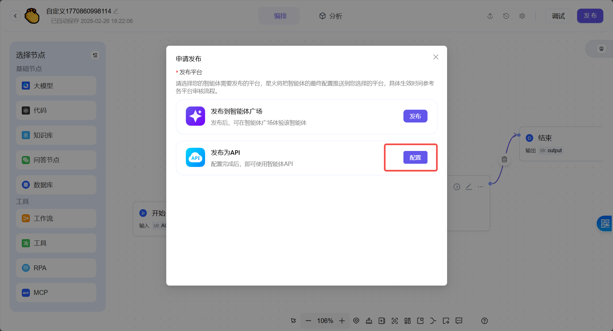

2. 绑定一个应用；如果还没有应用，点击「立即创建」新建一个。

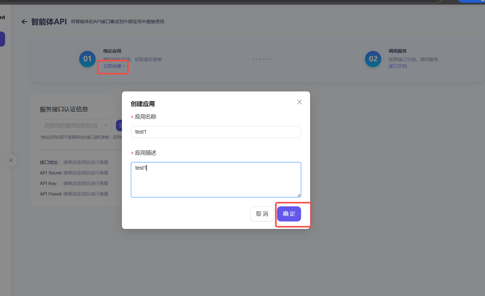

3. 绑定成功后即可在「服务接口认证信息」中看到接口地址、API Secret、API Key 和 API Flowid，页面还提供 Python 和 HTTP 示例下载。

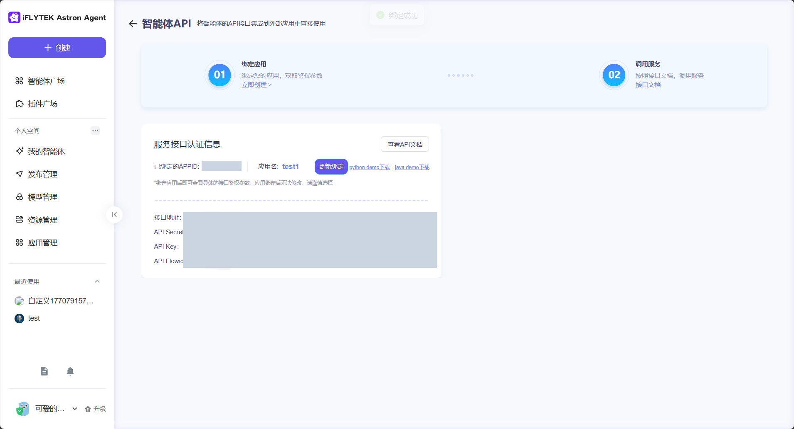

注意：应用绑定后无法修改，请谨慎选择。调用时鉴权头格式为 `Authorization: Bearer {API_KEY}:{API_SECRET}`。

## 工作流怎么实现视觉理解（图片理解）？

目前暂不支持原生多模态大模型的视觉输入，可以通过插件广场中的「图片理解」「文生图」等插件实现相关能力；原生多模态支持将在后续版本推出。

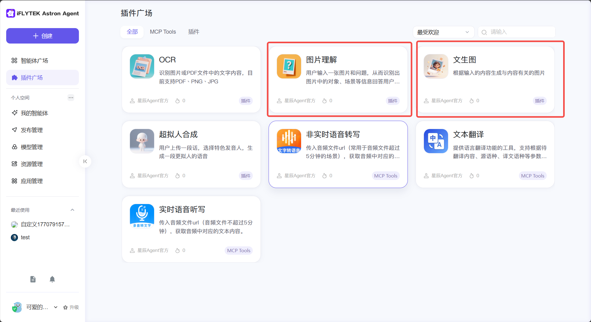

## 发送邮件插件怎么正确配置？

1. **使用授权码而不是登录密码**。以 QQ 邮箱为例，在邮箱设置中开启 POP3/IMAP/SMTP 服务并「生成授权码」，把授权码填入插件配置。

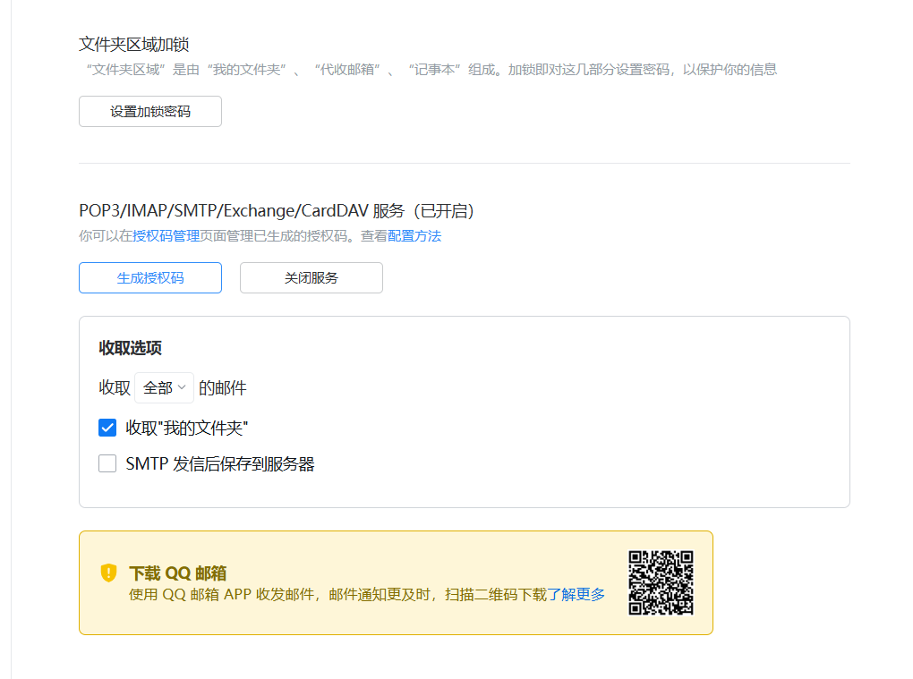

2. **收件邮箱地址要配置为数组格式**，即使只有一个收件人。

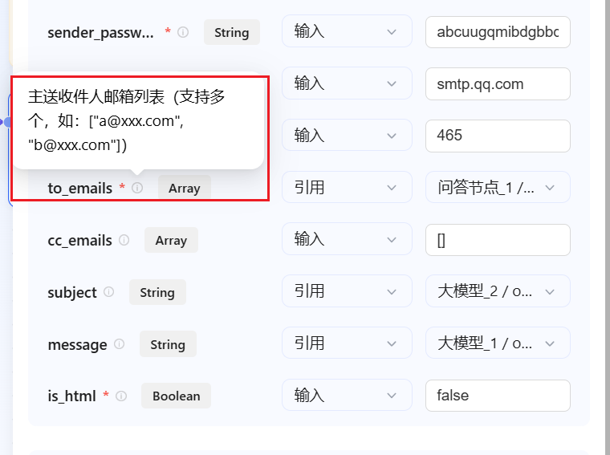

## 在工作流画布中怎么批量选择和复制节点？

1. 点击画布底部工具栏最左侧的交互模式按钮，切换到「触控板友好模式」。

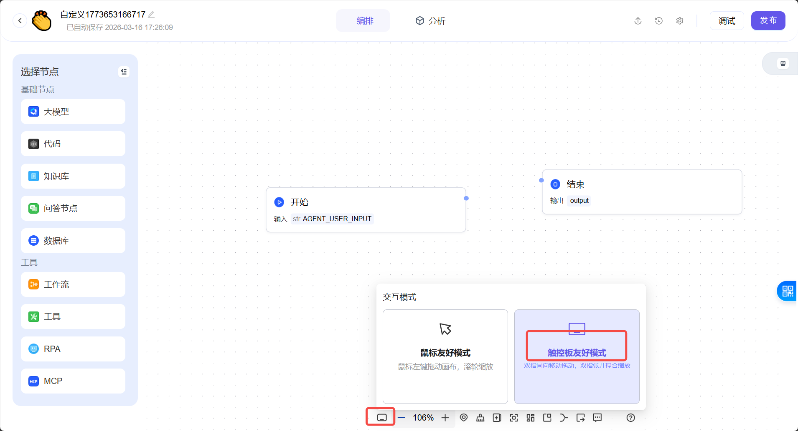

2. 之后就可以在画布上框选多个节点，复制粘贴即可。

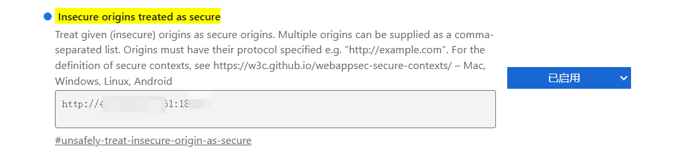

## 工作流的调用链路日志（Trace）怎么开启？

1. 在 `docker-compose.yaml` 中取消 `elasticsearch`、`kibana`、`kafka`、`logstash` 四个组件容器的注释。

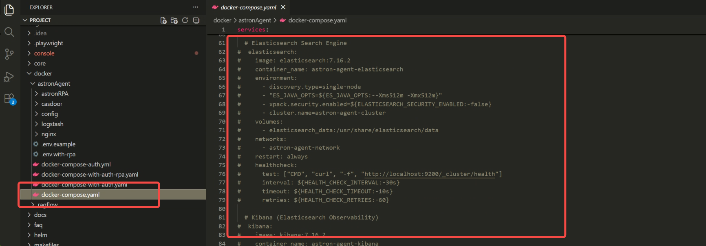

2. 将环境变量 `KAFKA_ENABLE` 置为 `1`。
3. 重新启动项目，编排页右上角会出现「Trace日志」入口，点击即可查看对应的调用链路。

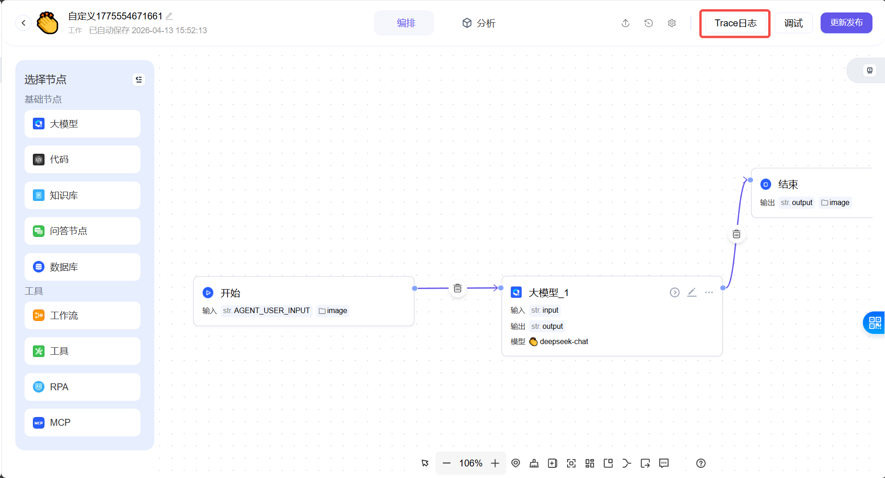

## 标准 HTTP 插件只支持 JSON Object，但接口要求顶层是 JSON Array 怎么办？

工作流中的标准 HTTP 插件节点默认请求体为 JSON Object（键值对）。如果外部接口强制要求顶层为数组（例如 `[{"skuId": ...}]`），建议改用**代码节点**：用一小段 Python 直接构建所需的数组结构并发起请求，从而绕过插件的结构限制。

## RPA 客户端创建 API Key 时提示 502 Bad Gateway？

1. 查看 `openapi-service` 服务的日志定位具体报错。
2. 尝试执行 `docker compose pull` 将 `openapi-service` 镜像更新到最新版本后重启。

## Agent 怎么调用 RPA？

RPA 使用外部平台既有 API Key 接入资源管理和工作流执行。外部 RPA 独立部署与登录，Astron Agent 不提供联合登录，也不修改外部 RPA 源码、镜像和部署。

## Agent 有几种接入 RAG（知识库）的方式？

两种：

1. **自建 RAGFlow**：自行部署开源 RAGFlow，或使用 `docker/ragflow` 目录下的脚本部署，然后通过 `RAGFLOW_*` 等环境变量接入。
2. **星火云端知识库**：关联讯飞开放平台并开通知识库能力，获取知识库数据集 ID 后配置到环境变量。

两种方式的详细步骤参见部署文档 `docs/zh/DEPLOYMENT_GUIDE_WITH_AUTH.md`。

## 智能体输出多模态内容（文字、图片、代码）时，前端如何解析显示？

前端统一按 Markdown 格式标准进行解析与渲染，因此智能体输出时按 Markdown 语法组织内容即可正确显示。
