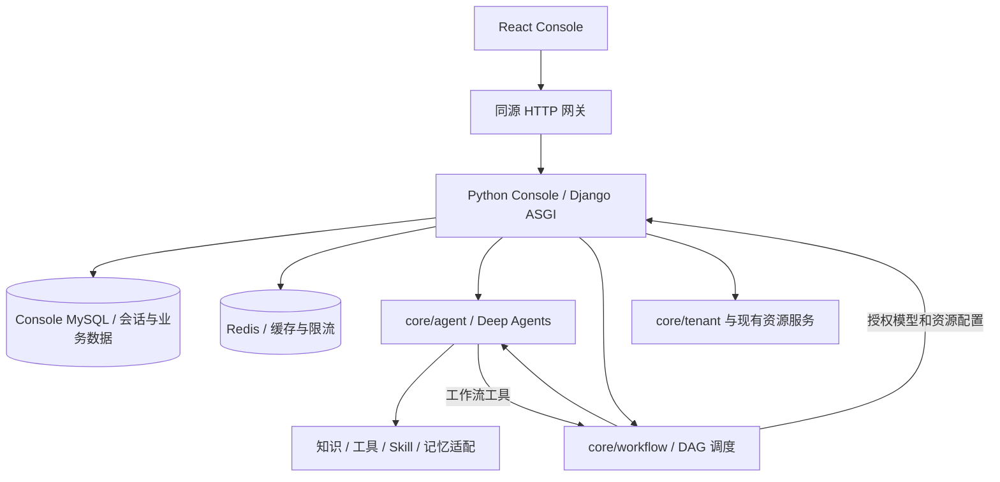

# Python Console 目标架构

范围与依赖见 [requirements.md](requirements.md)。架构覆盖整体迁移，当前实现范围为 04 工作流与 Agent 引用，建立在 01 账号、02 空间资源与 03 独立 Agent 基础上。

## 职责与调用方向

Console 采用模块化 Python 服务：accounts、spaces/resources、agents/conversations、workflows、publishing。不会按 Maven 模块机械翻译，也不将控制台管理逻辑塞入 core/agent。其余 core 服务保留现有框架与服务边界。

控制台选择 Django 官方账号、会话、密码校验、ORM 和迁移能力。用户名密码是首版唯一登录方式；FastAPI Users 的标准注册模型要求 email，为避免虚构邮箱/重写身份框架，控制台使用原生支持用户名的 Django。这个选择不要求 core 服务改框架。后续长连接以 ASGI 异步响应实现，业务执行仍在 core 服务。

## 账号与数据边界

- 浏览器只使用同源 HttpOnly 会话 Cookie；Django CSRF 中间件保护状态变更，密码经官方哈希器处理。没有 Casdoor/OAuth 令牌兼容和浏览器 bearer 刷新流程。
- `user_info.uid` 是持久业务身份，旧表的主键、资料、资源归属不变。新认证用户以相同 UID 建立认证记录。新注册创建独立随机 UID 并在同一事务中创建用户资料。
- 先导入并保留所有历史账号名称，再开放注册；缺失或冲突标识必须显式处理，不通过注册认领历史资源。账号状态以用户资料与认证记录共同约束。
- 账号初始无可用密码；受信任管理员通过本机命令生成一次性、限时重设凭据，交付本人后设置密码。服务器不公开发放凭据，也不依赖旧 Casdoor 密码。
- 新增会话/认证表，不运行旧 Flyway 初始 DROP TABLE 脚本。既有 user_info 表在迁移中接管，新库创建同结构用户表。用户数据迁移与代码兼容分开。
- 浏览器账号身份、应用/API 密钥和服务间身份是三个不同边界。删除 Casdoor 不表示删除空间权限、工作流内部密钥或沙箱凭据；后续子需求继续迁移对应授权端点。

## Agent 定义与运行契约

Console 保存 Agent 定义、草稿及不可变发布版本。执行时解析模型/工具/知识引用并校验调用用户权限，形成统一执行配置；凭据仅在可信运行请求中传递。

独立聊天和工作流 Agent 节点都调用 core/agent。工作流内联配置也转换为同一执行配置，不建立第二套循环。新运行解析最新已发布 Agent 版本并记录 resolved version；重试与恢复复用，不能被同时发生的发布改变。

历史按聊天会话或 workflow run/node 隔离。长期偏好命名空间使用空间、用户与稳定 Agent ID，跨入口和版本共享；调用来源保留在审计信息。工作流中间值和工具原始内容不自动写入偏好。core/memory/database 的数据库服务不被误当作 Mem0 长期记忆实现。

Agent 调用工作流、工作流调用 Agent 是明确的执行依赖，后续必须携带调用链与总预算并限制循环；Console 只提供配置/授权，不同步阻塞等待自身执行请求。

## 分阶段实现与部署

01 启用 Python Console 的账号范围，不通过 Java 代理补齐未迁移接口。现有部署服务名可继续使用 console-hub，镜像内容替换为 Python；这不是双实现兼容。未迁移 Java 业务源码在其所属子需求实现后删除，不能成为 Python 运行依赖。

每项只验收本范围；测试使用独立环境，不将中间产物合并主分支或宣告全量发布。Compose、Helm、CI 按当前部署范围更新，最后一项确认所有业务、文档和 Java 构建依赖清理。

## 01 影响评估

影响：前端登录入口、资料、HTTP/SSE/上传身份传递；Console 账号表、user_info、会话；Redis 限流；Nginx、Compose、Helm、认证 CI。当前不改 core/common、Kafka、MinIO 内容、租户数据或核心服务鉴权。删除 Casdoor 容器定义不删除已有数据卷或数据库。尚未迁移的网关应用鉴权与资源内部接口应明确拒绝，不能开放绕过。

## 官方依据

- [Django 自定义用户](https://docs.djangoproject.com/en/5.2/topics/auth/customizing/)
- [Django 认证与重设密码](https://docs.djangoproject.com/en/5.2/topics/auth/default/)
- [Django 数据迁移操作](https://docs.djangoproject.com/en/5.2/ref/migration-operations/)

以上 API 经 Context7 核验；实现锁定实际可安装的 Django 5.2 维护版本。

## 02 影响评估

前端空间与资源页面 → Django spaces/resources/knowledge → 既有 Console 业务表及 core/plugin、core/knowledge、core/memory/database。内部模型/沙箱/产物接口读取已有工作流归属用于授权，不实现工作流编排。保留配置权限位、业务 UID 和资源主键；MinIO 复用既有桶和对象键。平台账号的 config_info JSON 与 platform_account_text:* Redis 文本缓存被多个 core 服务消费，保存时定向失效缓存；不读取 Java 对象缓存，不改 Kafka/core/common。具体契约与验证见 [02 技术设计](02-resources/technical-design.md)。

## 03 影响评估

独立聊天与调试由 React → Django agents → core/agent → DeepAgentsRunner 统一执行。Django 接管原 Agent 定义、人格和收藏，新增不可变快照、发布指针及按用户/空间隔离的会话执行记录；原历史以确定性 ID 非破坏导入。取消标记与心跳在 MySQL 中协调，ASGI 断连关闭上游流，保存实际部分响应。模型、MCP、插件、Skill 和知识引用复用02的权限与资源记录，凭据不进入快照或前端。

Mem0 保留原 RSA 配置、用户 UID 与 `bot-<稳定Agent ID>`，以空间 metadata 限定长期偏好；不按版本或入口切分，不把工作流中间结果自动写入。04/05仅接收版本解析和发布指针契约，本阶段不实现它们的节点、运行生命周期和发布渠道。删除已替代的 Java Spring AI、独立聊天/调试/记忆及重复工具循环；共享的未迁移工作流数据和原 SQL 保留。具体边界见 [03 技术设计](03-agents/technical-design.md)。

## 04 影响评估

React画布 → Django workflows（管理、授权、冻结图与Agent版本、运行记录）→ core/workflow现有调度 → core/agent统一执行。Agent工作流工具经Console建立受限子运行，共享根取消和调用预算；Core EventRegistry扩展事件级取消，暂停恢复保持原活跃执行，不冒充持久化恢复。复用02产物及03偏好，不改变原UID、数据、密钥和Mem0命名空间。具体契约与验证见[04技术设计](04-workflows/technical-design.md)。
